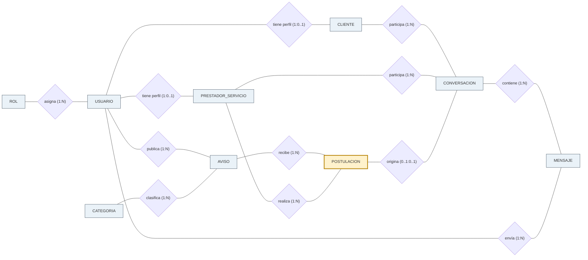
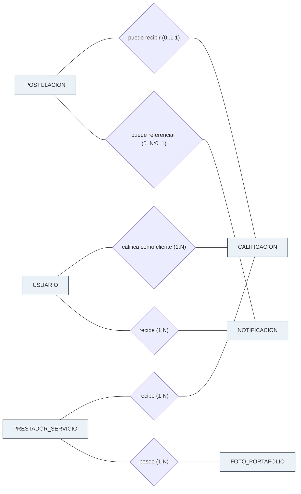
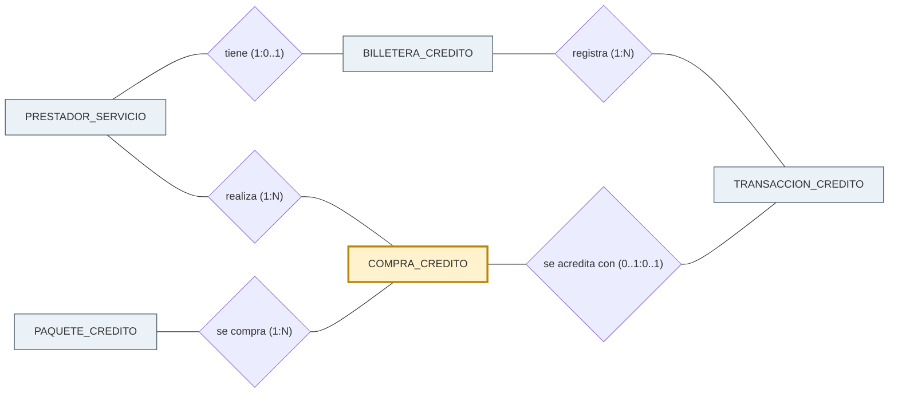

# Modelo Entidad-Relación (MER) de OficiosYa

Este es un modelo conceptual, en notación clásica: **rectángulos** representan
tablas y **rombos** representan relaciones. Se omiten los atributos para que
se vea con claridad cómo se conectan las tablas. Los rombos incluyen la
cardinalidad de la relación.

## Diagrama conceptual

### Usuarios, avisos y comunicación



### Calificaciones, notificaciones y portafolio



### Créditos y compras



### Leyenda

- Los rectángulos azules son tablas del modelo.
- Los rombos son relaciones entre tablas.
- Las tablas intermedias aparecen resaltadas en amarillo.
- `1:N` significa uno a muchos; `1:0..1` significa uno a cero o uno.
- La cardinalidad se lee en el orden de las tablas conectadas: izquierda a
  derecha.
- Cuando una relación tiene cardinalidad opcional en ambos extremos se indica
  como `0..1:0..1`.
- Los diagramas están divididos por área para que sean más legibles; las tablas
  que aparecen en más de un diagrama son la misma tabla, no copias distintas.

## Tablas intermedias

Las siguientes tablas ya existen en el modelo; se resaltan porque resuelven
relaciones que conceptualmente son de muchos a muchos:

1. **`POSTULACION`** conecta `AVISO` con `PRESTADOR_SERVICIO`. Un aviso puede
   recibir postulaciones de muchos prestadores, y un prestador puede postularse
   a muchos avisos. La fila de postulación representa cada combinación aviso-
   prestador y también registra el estado y presupuesto de esa propuesta.
2. **`COMPRA_CREDITO`** conecta `PRESTADOR_SERVICIO` con `PAQUETE_CREDITO`.
   Un prestador puede comprar varios paquetes y un paquete puede ser comprado
   por muchos prestadores. Cada compra guarda su propio estado y el precio
   acordado en ese momento.

No se agregó una tabla nueva a la base de datos para este diagrama: se están
mostrando las tablas intermedias que ya implementa el proyecto.

## Cómo se mueve la información

### 1. Registro y creación de perfil

1. Se crea una fila en `USUARIO`, vinculada a un `ROL`.
2. Según el rol inicial, se crea el perfil en `CLIENTE` o
   `PRESTADOR_SERVICIO`. El perfil guarda el `id_usuario`.
3. Si empieza como prestador, se crea su `BILLETERA_CREDITO` y la transacción
   inicial se guarda en `TRANSACCION_CREDITO`.
4. Cambiar de rol actualiza el rol activo de `USUARIO`; los perfiles existentes
   se conservan y se crea el que falte.

Un mismo usuario puede terminar teniendo ambos perfiles, aunque mantiene un
solo rol activo en `USUARIO.id_rol`.

### 2. Aviso, postulación y conversación

```text
USUARIO (cliente) → AVISO ← CATEGORIA
                         ↓
                    POSTULACION ← PRESTADOR_SERVICIO
                         ↓ aceptar
                    CONVERSACION → MENSAJE ← USUARIO (remitente)
```

El cliente publica un aviso asociado a una categoría. Los prestadores realizan
postulaciones que guardan presupuesto y estado. Cuando el cliente acepta una
postulación, se crea la conversación asociada; los mensajes apuntan a esa
conversación y también identifican al usuario que los envió.

La base impide que un prestador se postule dos veces al mismo aviso mediante
una restricción única sobre `(id_aviso, id_prestador)`. La conversación puede
tener `id_postulacion` nulo y, si lo tiene, ese ID es único.

### 3. Compra de créditos

```text
PRESTADOR_SERVICIO → COMPRA_CREDITO → PAQUETE_CREDITO
                           │
                           │ external_reference = compra.id
                           ▼
                     Mercado Pago (externo)
                           │ webhook aprobado y validado
                           ▼
TRANSACCION_CREDITO → BILLETERA_CREDITO → PRESTADOR_SERVICIO
          ▲
          └──────── COMPRA_CREDITO.transaccion_id
```

`COMPRA_CREDITO` guarda una copia de la cantidad, precio y moneda del paquete
al momento de iniciar la compra. Mercado Pago no es una tabla de la base: es un
sistema externo. El backend usa `external_reference` para encontrar la compra
local cuando recibe la notificación de pago.

Solo después de validar la firma del webhook, consultar el pago y verificar
importe y moneda, se registra el movimiento en `TRANSACCION_CREDITO`, se
actualiza la billetera y se vincula la transacción con la compra. El saldo
actual es una vista rápida del estado; las transacciones conservan el
historial de movimientos.

`referencia_id` y `referencia_tipo` en `TRANSACCION_CREDITO` sirven como
referencia lógica al origen del movimiento, pero no son una clave foránea.

### 4. Finalización y calificación

Al finalizarse un trabajo, el cliente puede crear una calificación de la
postulación aceptada. `CALIFICACION` relaciona la postulación, el usuario
cliente y el prestador. La restricción única sobre `id_postulacion` permite
como máximo una calificación por postulación; la puntuación debe estar entre
1 y 5.

Las imágenes de comprobantes y portafolio se guardan en Cloudinary. En
PostgreSQL se almacenan sus URLs y los `public_id` que permiten administrar o
eliminar esos archivos en Cloudinary.

## Decisiones del modelo que conviene explicar

- **El saldo y el historial tienen propósitos distintos:** `BILLETERA_CREDITO`
  contiene el saldo actual; `TRANSACCION_CREDITO` registra cómo cambió.
- **El precio de compra se copia:** una modificación futura de un paquete no
  cambia las compras ya creadas.
- **Mercado Pago y Cloudinary no son entidades relacionales locales:** sus
  referencias se conservan en campos como `referencia_pago`, `url_pago` y
  `public_id`.
- **Hay claves foráneas que apuntan a `USUARIO` aunque el concepto sea
  cliente:** por ejemplo, `AVISO.id_cliente` y `CALIFICACION.id_cliente`.
  La tabla `CLIENTE` existe para el perfil y para relaciones como
  `CONVERSACION.id_cliente`.
- **El MER muestra relaciones guardadas en la base:** reglas como “solo un
  cliente puede publicar un aviso” también se validan en la lógica de la API.

## Explicación oral breve

> “El usuario es la entidad central y tiene un rol activo. Sus perfiles de
> cliente y prestador se guardan por separado. El cliente publica avisos y los
> prestadores crean postulaciones; al aceptar una, se habilita una conversación
> con mensajes. Para créditos, la compra se relaciona con el prestador y el
> paquete. Mercado Pago confirma externamente el pago; el backend registra una
> transacción y actualiza la billetera solo después de validar el webhook. Las
> calificaciones se vinculan a la postulación terminada, y las imágenes se
> guardan en Cloudinary mientras la base conserva sus referencias.”
